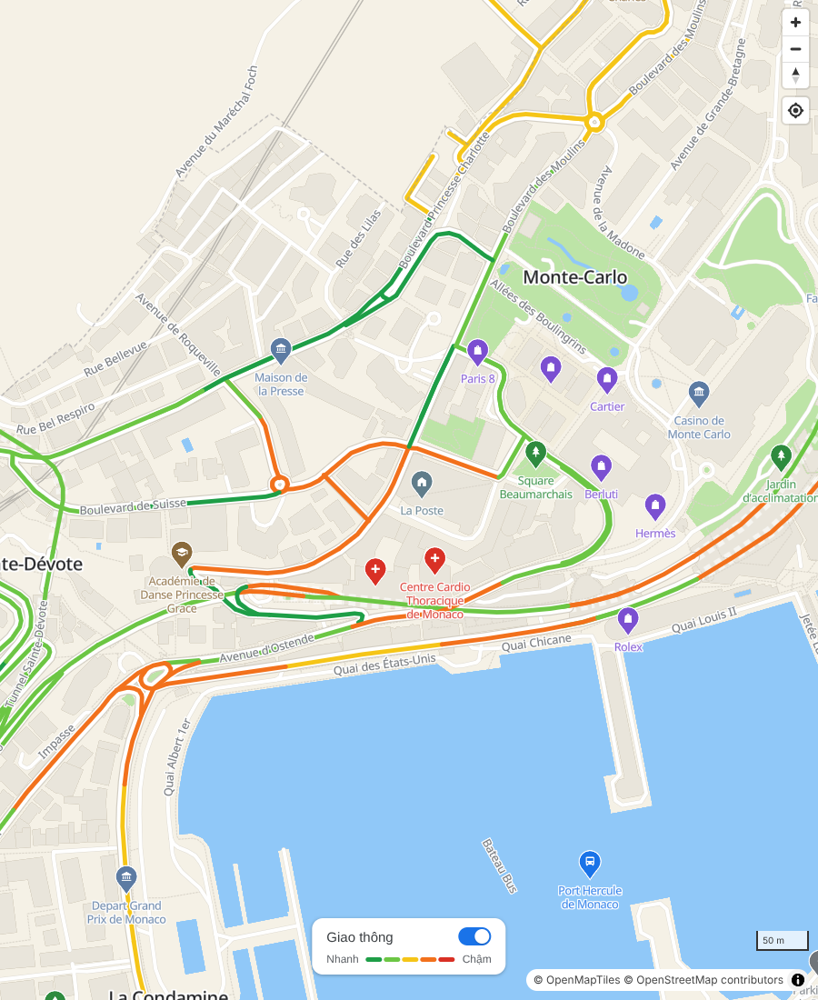

# qhmaps

Bản đồ OpenStreetMap **tự host hoàn toàn**, giao diện giống Google Maps: nền be nhạt, công viên xanh lá, nước xanh dương, đường trắng, ghim POI có màu theo nhóm, nhãn tiếng Việt, lớp giao thông có công tắc và chú giải "Nhanh → Chậm".

Không dùng API bên thứ ba, không cần key: tile vector, font, style và thư viện (MapLibre GL, PMTiles) đều nằm trên server của bạn.



*Ảnh render từ dữ liệu OSM thật (Monaco, vì môi trường build không tải được dữ liệu Việt Nam). Lớp giao thông là dữ liệu mô phỏng.*

## Cách hoạt động

```
OpenStreetMap (.osm.pbf)
   └─ Planetiler ─► data/hcmc.pmtiles   (một file tile vector, lược đồ OpenMapTiles)
                        │
styles/google-like.json ┤  + assets/fonts/  + demo/vendor/ (MapLibre, PMTiles)
                        ▼
              web server tĩnh bất kỳ (nginx, Caddy, GitHub Pages...)
```

## Chạy thử

Cần Node 18+ và Java 21+ (hoặc Docker).

```sh
npm run tiles   # lần đầu: tải dữ liệu OSM Việt Nam + Planetiler, cắt khung TP.HCM -> data/hcmc.pmtiles
npm run serve   # mở http://localhost:8080/demo/
```

Mạng chỉ cần ở lần chạy `npm run tiles` để tải dữ liệu OSM (Geofabrik) và Planetiler. Sau đó bản đồ chạy offline.

Tuỳ chọn cho `npm run tiles`:

| Biến | Mặc định | Ý nghĩa |
| --- | --- | --- |
| `BOUNDS` | `106.35,10.35,107.05,11.20` | Khung bao (tây,nam,đông,bắc); `world` để lấy cả file |
| `AREA` | `vietnam` | Tên vùng trên Geofabrik |
| `OSM_FILE` | `data/sources/vietnam.osm.pbf` | Dùng file `.osm.pbf` có sẵn |
| `OUTPUT` | `data/hcmc.pmtiles` | File kết quả |
| `USE_DOCKER` | `0` | `1` để chạy Planetiler bằng Docker thay cho Java |
| `JAVA_MEM` | `4g` | Bộ nhớ cho Java |

Ví dụ cả Việt Nam: `BOUNDS=world OUTPUT=data/vietnam.pmtiles npm run tiles`, rồi mở `/demo/?tiles=data/vietnam.pmtiles`.

Khi đưa lên server, web server phải hỗ trợ HTTP Range (nginx, Caddy, Apache, S3 đều có sẵn) vì PMTiles đọc từng phần của file.

## Cấu trúc

| Đường dẫn | Nội dung |
| --- | --- |
| `styles/google-like.json` | Style MapLibre (sinh ra, đừng sửa tay) |
| `scripts/build-style.mjs` | Nguồn của style: bảng màu, nhóm POI, độ rộng đường |
| `scripts/build-tiles.sh` | Tạo PMTiles từ dữ liệu OSM bằng Planetiler |
| `scripts/vendor.mjs` | Chép MapLibre GL và PMTiles vào `demo/vendor/` |
| `assets/fonts/` | Font glyph Noto Sans (hỗ trợ tiếng Việt) |
| `demo/` | Trang demo: ghim POI, lớp giao thông, ghim đỏ địa điểm |

## Sửa style

```sh
npm install
npm run build      # sinh lại styles/google-like.json
npm run validate
```

Đổi màu trong object `C` và `POI_COLORS` ở `scripts/build-style.mjs`.

Style dùng chỗ giữ `{base}` cho đường dẫn tile và font; `demo/app.js` thay bằng địa chỉ thư mục gốc của repo. Trong ứng dụng khác, thay `{base}` rồi đăng ký giao thức `pmtiles` như trong `start()`.

Biểu tượng POI không nằm trong sprite mà được vẽ bằng canvas: gọi `registerPoiIcons(map)` từ `demo/icons.js` sau sự kiện `load` và trong `styleimagemissing`.

## Lớp giao thông

OpenStreetMap **không có dữ liệu kẹt xe thời gian thực**. Bản demo mô phỏng (`demo/traffic.js`): cắt các đường chính thành đoạn ~150 m và gán mức 0–4, đổi mỗi 2 phút. Khi có dữ liệu thật (GPS xe của bạn, đối tác...), đổ GeoJSON vào nguồn `traffic`:

```js
import { setTrafficData } from './traffic.js';
setTrafficData(map, {
  type: 'FeatureCollection',
  features: [{ type: 'Feature', properties: { level: 3 }, geometry: { type: 'LineString', coordinates: [...] } }],
});
```

`level`: 0 thông thoáng, 1 khá nhanh, 2 trung bình, 3 chậm, 4 kẹt xe.

## Giấy phép dữ liệu

Dữ liệu bản đồ © OpenStreetMap contributors (ODbL), lược đồ tile © OpenMapTiles. Giữ dòng ghi công ở góc bản đồ.
